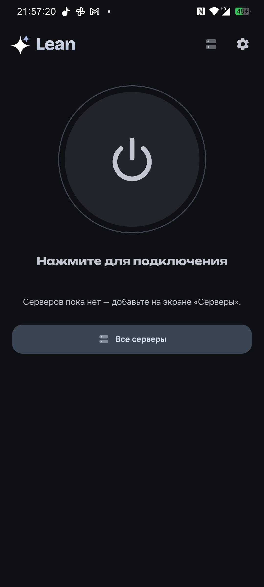
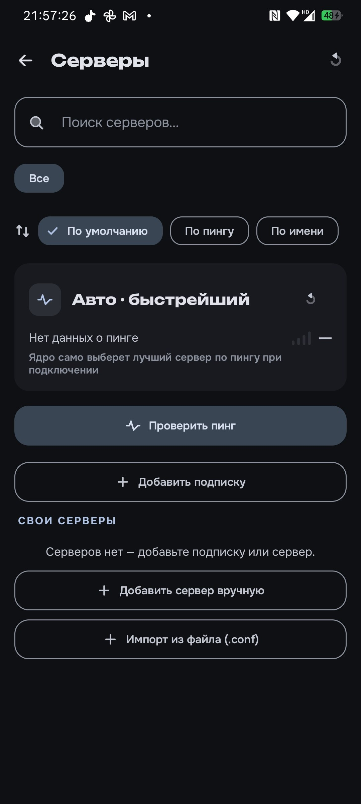
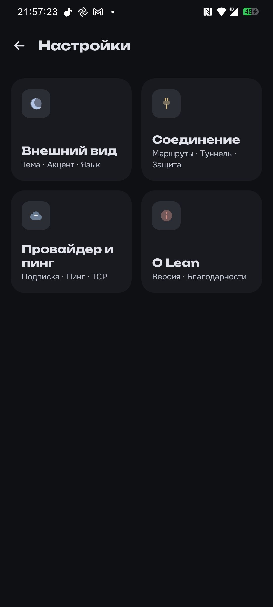
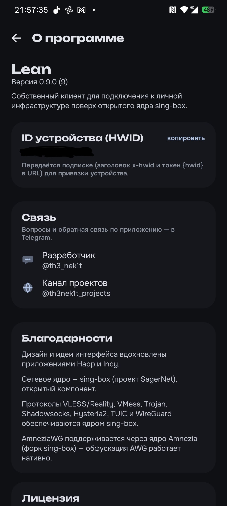

# Lean

VPN-клиент для Android 7.0 и новее.

[**⬇️ Скачать**](../../releases/latest) · [Сайт](https://th3web.com/lean/) · [Канал проектов](https://t.me/th3nek1t_projects) · [Поддержка](https://t.me/th3_nek1t) · [Boosty](https://boosty.to/th3nekit)

  
  
  
  

---

> ### Переход со старого пакета
>
> У приложения сменился идентификатор пакета: `ru.th3web.lean` → `com.th3web.lean`.
> Для Android это другое приложение, поэтому обновление «поверх» невозможно.
>
> **Как перенести настройки и серверы:**
> 1. в старой версии: «Настройки» → «Резервная копия» → **Экспорт**, сохраните файл;
> 2. установите новую версию (старую пока не удаляйте);
> 3. в новой: «Настройки» → «Резервная копия» → **Импорт**, выберите тот файл;
> 4. убедитесь, что серверы на месте и подключение работает, и удалите старую версию.
>

## Что это

Lean подключается к серверам из подписки, ссылки или файла конфигурации.
В приложении нет рекламы. Можно использовать своего провайдера или сервер.

## Возможности

- **Протоколы:** VLESS/Reality, VLESS over XHTTP, VMess, Trojan, Shadowsocks, Hysteria2,
  TUIC, WireGuard, AmneziaWG, NaiveProxy, Mieru и olcRTC. Доступность зависит от
  варианта сборки и архитектуры устройства.
- **Режим работы:** системный туннель, локальный прокси или оба сразу.
- **Оформление:** готовые образы (в т.ч. AMOLED, светлая, плотный «терминальный» стиль),
  свои обои с размытием, цвет акцента из обоев, шрифты, скругления, плотность интерфейса;
  всё меняется вживую с предпросмотром. До 10 своих образов, каждым можно поделиться
  строкой-кодом.
- **Подписки** и share-ссылки, импорт конфигов `.conf` / `.json` / `.yaml`, deep-link `lean://`.
- **Плитка** быстрых настроек, авто-выбор быстрейшего сервера, проверка пинга и сортировка.
- **Раздельный туннель** по приложениям (с иконками), kill-switch, выбор DNS, обход
  локальной сети.
- **Маршрутизация:** режим «российские сайты напрямую» и свои rule-set'ы geoip/geosite.
- Русский и английский. Мультиарх: `arm64-v8a`, `armeabi-v7a`, `x86_64`, `x86` + универсальный APK.

## Скачать

APK и контрольные суммы находятся на странице [Releases](../../releases/latest).

| Архитектура | Устройство |
|---|---|
| arm64-v8a | Большинство современных телефонов |
| armeabi-v7a | Старые устройства ARM с 32-битной системой |
| x86 / x86_64 | Устройства и эмуляторы Intel/AMD |
| Универсальный | Если архитектура неизвестна |

Каждый релиз сопровождается `SHA256SUMS.txt` — можно сверить контрольную сумму скачанного APK.

Не уверены — берите **универсальный**. После загрузки разрешите установку из неизвестного
источника, откройте APK, импортируйте подписку или конфиг и подключайтесь.

Версии для iOS нет.

## Поддержка

Вопросы и обратная связь — [@th3_nek1t](https://t.me/th3_nek1t).
Новости и сборки — [@th3nek1t_projects](https://t.me/th3nek1t_projects).
Обсуждение на [4PDA](https://4pda.to/forum/index.php?showtopic=1122995).

Lean бесплатный, без рекламы. Поддержать разработку — [Boosty](https://boosty.to/th3nekit).

## Лицензия

**GPL-3.0-or-later** — см. [LICENSE](LICENSE).

Приложение использует sing-box и libcore из NekoBox for Android под GNU GPL
версии 3 или новее. Исходный код распространяемых сборок доступен в репозитории.

### Исходный код

Исходный код публикуется в этом репозитории. Если нужной версии здесь ещё нет —
напишите [@th3_nek1t](https://t.me/th3_nek1t), исходники любой распространявшейся
сборки предоставляются по запросу.

### Компоненты

| Компонент | Автор | Лицензия |
|---|---|---|
| libcore (форк sing-box) | NekoBox for Android, MatsuriDayo | GPL-3.0-or-later |
| AmneziaWG-Go + JNI-обвязка | Amnezia VPN | MIT / Apache-2.0 |
| Xray-core | XTLS | MPL-2.0 |
| NaiveProxy | klzgrad | BSD-3-Clause |
| Mieru | enfein | GPL-3.0 |
| olcRTC | OpenLibreCommunity | WTFPL |

Тексты лицензий входят в сборку («О программе» → «Лицензии»), точные ревизии
зафиксированы в исходниках.
